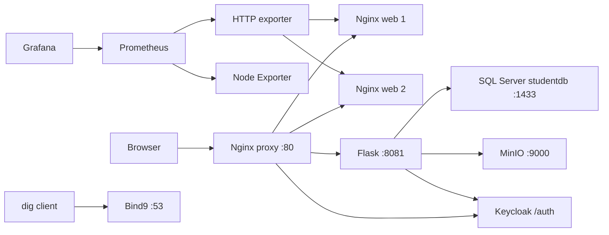

# Kiến trúc MyMiniCloud — project Docker `mycloud`

## Nguồn yêu cầu và quyết định

Đã đọc PDF `Báo Cáo Cuối Kỳ.docx.pdf` đủ 27 trang, master prompt cập nhật và tài
liệu khảo sát. Thứ tự ưu tiên: yêu cầu người dùng mới nhất → master implementation
plan mới → PDF đề bài → tài liệu kế hoạch trước đó. Tài liệu khảo sát gốc giữ nguyên.

Các khác biệt có chủ đích:

- SQL Server 2022 Developer theo người dùng, thay các ví dụ MariaDB/MySQL của PDF.
  `AUTO_INCREMENT` đổi thành `IDENTITY`, giữ `studentdb.dbo.students` và API.
- 9 nhóm dịch vụ dùng nhiều container: 2 web replica, exporter và init jobs phụ trợ.
- HTTP exporter kiểm tra web; không scrape HTML cổng 80 như metrics.
- File MinIO private, download qua backend thay URL public bucket trong ví dụ PDF.
- Dùng Grafana visualization + Compose logs; chưa triển khai log tập trung Loki.
- Không dùng các lệnh dừng/xóa toàn bộ container minh họa trong PDF trang 11.
- Local trước; AWS và Docker Hub chỉ được PASS khi có kiểm thử thật.

## Sơ đồ và luồng request

- Blog: Browser → proxy round robin → web1 hoặc web2 → HTML/assets; không gọi SQL.
- Student App: web trả HTML/JS → JS `/api/students-db` → proxy strip `/api/`
  → Flask `/students-db` → SQL Server → JSON. Các method ghi giữ nguyên khi proxy.
- OIDC: frontend lấy config → Keycloak login PKCE → callback `/app/` → token;
  `/api/secure` được Flask xác minh RS256/JWKS, issuer public và audience `flask-app`.
- Storage: browser multipart → Flask kiểm tra file → bucket private → trả object key;
  đọc file đi qua Flask. Không lộ credential MinIO.
- Monitoring: Prometheus chủ động scrape Node Exporter và HTTP exporter;
  Grafana chủ động query Prometheus. Node Exporter ở Docker Desktop đo Linux VM,
  không tự nhận là tài nguyên Windows hoặc từng container.

## Bảng dịch vụ

Tất cả service dùng network `cloud-net`, restart `unless-stopped` cho tiến trình
chạy lâu dài. Init job restart `no`, phải hoàn tất trước service phụ thuộc.
Container để Compose sinh tên `mycloud-<service>-1`, tránh tên toàn cục.

Cấu hình mục tiêu có **12 container thường trực cho 9 nhóm dịch vụ**:
thêm 1 web replica, Node Exporter và Blackbox Exporter so với một container
đại diện mỗi nhóm. Exporter phụ trợ Monitoring, replica phụ trợ nhóm Web;
không tạo nhóm server nghiệp vụ mới. Ba init jobs và test runner tạm thời
được thống kê riêng. Giao diện theo [ui-requirements.md](ui-requirements.md).

| Nhóm / service | Image dự kiến | Port nội bộ → host | Persistence / source |
| --- | --- | --- | --- |
| web-frontend-server1/2 | `mycloud-web:1.0.0`, nền `nginx:1.28-alpine` | 80 → không publish | `web/`, chung nội dung |
| application-backend-server | `mycloud-app:1.0.0`, nền Python 3.12 Debian | 8081 → không publish | `app/`, ODBC Driver 18 |
| relational-database-server | `mcr.microsoft.com/mssql/server:2022-CU22-ubuntu-22.04` | 1433 → `127.0.0.1:1433` | `mycloud_mssql-data` → `/var/opt/mssql` |
| database-init | image app, chạy migration/seed T-SQL | không publish | `db/init/001_init.sql`; retry có giới hạn |
| authentication-identity-server | `quay.io/keycloak/keycloak:26.1.4` | 8080 → qua `/auth/` | `mycloud_keycloak-data`; start-dev chỉ local |
| auth-init | image app, bootstrap realm/client/2 user | không publish | `auth/`; secret local |
| object-storage-server | `minio/minio:RELEASE.2025-04-22T22-12-26Z` nếu pull được | 9000/9001 → loopback cùng cổng | `mycloud_minio-data` |
| internal-dns-server | `internetsystemsconsortium/bind9:9.18` | 53 → loopback 1053 TCP/UDP | `dns/`, zone `cloud.local` |
| monitoring-node-exporter-server | `prom/node-exporter:v1.9.1` | 9100 → nội bộ | metrics Linux VM |
| monitoring-http-exporter-server | `prom/blackbox-exporter:v0.26.0` | 9115 → nội bộ | `monitor/blackbox.yml` |
| monitoring-prometheus-server | `prom/prometheus:v3.2.1` | 9090 → loopback 9090 | `mycloud_prometheus-data` |
| monitoring-grafana-dashboard-server | `grafana/grafana:11.6.0` | 3000 → loopback 3000 | `mycloud_grafana-data`, provisioning |
| api-gateway-proxy-server | `nginx:1.28-alpine` | 80 → host 80 | `proxy/nginx.conf` |

Image/tag là lựa chọn cho demo có phiên bản; cần pull/build và ghi digest thực tế
trước khi đánh dấu PASS. MinIO tag cũ được chọn để kiểm thử Console phù hợp demo,
không dùng image custom trong cache làm bằng chứng upstream. Nếu không kéo được,
ghi lỗi và phương án thay thế có nguồn; không âm thầm đổi công nghệ.

## Network và DNS

Audit hiện tại: bridge `172.17.0.0/16`, gk `172.18.0.0/16`, network khác
`172.20.0.0/16`; Windows có LAN `192.168.1.0/24`, WSL `172.22.240.0/20`.
Subnet dự kiến riêng `172.30.50.0/24` không trùng những route cụ thể đã kiểm tra
(không tính default/multicast). Kiểm tra lại trước khi tạo, vì VPN có thể thêm route.

IPAM chỉ phục vụ DNS lab có bản ghi A ổn định: DNS `.53`, proxy `.10`, app `.20`,
MinIO `.30`, Keycloak `.40`, Grafana `.50`. Các service khác IP động. Kết nối
ứng dụng vẫn dùng service name; không sử dụng IP tĩnh trong DB/JWKS/S3 connection string.
Bind9 records gồm `web`, `web-frontend-server`, `app`, `app-backend`, `minio`,
`keycloak`, `grafana` trong `cloud.local`, chỉ đúng khi IPAM Compose khớp zone.

Docker DNS phục vụ service names. Bind9 authoritative phục vụ `cloud.local`,
kiểm thử bằng `dig @internal-dns-server app-backend.cloud.local` từ container
và host 1053. Windows không tự dùng zone này để duyệt web; Portal vẫn localhost.

## Health, credential và giao diện

- Health SQL thực hiện SELECT, app đợi migration và seed hoàn tất.
- Portal probe endpoint thực tế với timeout; `container_runtime_count` Unknown
  khi không đọc runtime. Không mount Docker socket.
- Keycloak issuer public `http://localhost/auth/realms/MSSV_PLACEHOLDER`, JWKS
  lấy qua service nội bộ; cấu hình proxy giữ `/auth` và ghi đè forwarded headers.
- Realm, mật khẩu bootstrap, demo users lấy từ `.env` đã ignore; tài khoản app SQL
  có quyền trên database riêng, không dùng `sa` để CRUD.
- `.env.example` chỉ placeholder; script tạo `.env` local ngẫu nhiên. Không in secret
  ra log hoặc commit output `docker compose config` chứa resolved environment.
- Public application routes `/`, `/blog/`, `/app/`; API chi tiết theo
  [api-contract.md](api-contract.md); quản trị dùng các port loopback đã chốt.

## Phân công và nghiệm thu

| Phần việc | Chủ sở hữu | Tiêu chí |
| --- | --- | --- |
| Portal, Blog, Student frontend | Gemini | `web/html/**`, API contract, responsive, không dữ liệu giả |
| Backend, SQL, auth/storage, Docker/DNS/metrics/proxy | Codex | Service thật, readiness, persistence, log và kiểm thử |
| Review, merge, Docker E2E và báo cáo | Codex | Đọc diff, kiểm tra bảo mật/contract, chạy thật, ghi bằng chứng |

PDF trang 21–27 được đối chiếu: 3 bài Blog → Gemini; JSON 5 mẫu → app/students.json;
studentdb → T-SQL; realm/client/users → auth-init; avatar/PDF → MinIO;
DNS record → Bind9; target web → HTTP exporter; 3 biểu đồ → Grafana provisioning;
`/student/` → proxy alias; round robin → header nhận diện hai web.

Docker Hub push và AWS EC2 vẫn NOT TESTED cho đến khi có repo/credential/phạm vi
triển khai tương ứng; không cản việc hoàn thành local. Remote Git sẽ do người dùng cung cấp.
